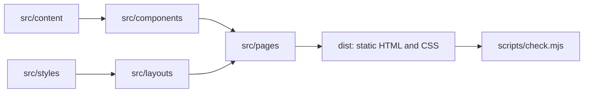

# Architecture

A small static site with one rule: content is separate from presentation, so changing what the site says never touches how it looks.

## Layers

| Folder | Holds | Rule |
| --- | --- | --- |
| `src/content/` | Copy, offers, legal data, brand settings | Data only, no markup or styles |
| `src/components/home/` | One component per home section | Reads content and owns its own styles |
| `src/components/layout/` | Header and footer | Used only by the layout |
| `src/components/shared/` | Pieces used across sections, such as `Button` | No content of their own |
| `src/layouts/` | The HTML shell: head, SEO, preview notice | One layout for every page |
| `src/pages/` | Routes that compose sections | No copy and no styles on the home page |
| `src/styles/global.css` | Design tokens, reset and shared rules | The only place for colors and spacing tokens |
| `scripts/` | The content check and its tests | Runs on the built output |

## Design rules

- Colors, margins and target sizes come from the tokens in `global.css`.
- Each view has one primary button. Use `variant="quiet"` for the others.
- Interactive targets are at least 44 px.
- Do not redraw the logo. `public/brand/hp-mark.webp` is a crop of Yera's original file; `site.logo.approved` blocks publishing until Yera validates it.
- Use real photos of Yera only. Mockups and sample figures are never content.

## Pending items

Anything unfinished renders with a `data-pending` attribute. `pnpm check:publish` lists those items and fails until they are gone, so nothing unfinished reaches a launch by accident.

## Growing the site

| Need | What to do | What stays the same |
| --- | --- | --- |
| A new page | Add a file in `src/pages/` using `BaseLayout` with `subpage` | Everything else |
| A new section | Add its data to `src/content/` and a component to `components/home/` | Other sections |
| Open the training or manual | Set `status: "available"` in `offers.ts` | Layout and styles |
| Custom domain | Change `site` in `astro.config.mjs` and configure DNS | Code |
| Editing without code (CMS) | Replace the imports from `src/content/` with data from the CMS, using the same shapes | Components |
| Payments | Move to a host with server support, add an Astro adapter and server endpoints | Pages and components |

## Prepared product destinations (inactive)

`offers.ts` holds the supplied Payhip destinations in optional `purchaseUrl` fields. The offer component does not render those fields, and both products remain `soon`. Changing a status to `available` still shows a contact button, not a purchase button.

Product visibility and a connected payment provider do not prove a successful purchase or delivery. Before implementing purchase buttons or launching:

- Obtain approval for the logo, contact CTA and legally reviewed owner/privacy information. Keep private identity and address evidence out of this public repository.
- Confirm a suitable hosting destination (see below).
- Verify purchase and delivery for each product with the owner's authorization, keeping transaction evidence private.
- On an authorized remote builder, run `pnpm verify`, then `pnpm build && pnpm check:publish`. Resolve every publication blocker without weakening the check.
- Inspect the generated preview HTML: no Payhip purchase links should appear while these destinations are inactive. After a separately approved activation, verify each button points to its matching product.

## Hosting

`.github/workflows/deploy.yml` deploys every push to `main`, unless the tests or the content check fail. It runs the check in preview mode: for a real launch, remove `--preview` so that pending items block the deploy.

GitHub Pages serves this version as a preview. It only hosts static files, and [its terms](https://docs.github.com/en/pages/getting-started-with-github-pages/github-pages-limits) do not allow it as free hosting for an online business or a site primarily facilitating commercial transactions. The site must move before payments are enabled. A custom domain keeps that move invisible to visitors.

## Not built on purpose

Payments, forms, video delivery, CMS, analytics and multiple languages. The specification for those is not closed yet, and building them now would mean rewriting them.
